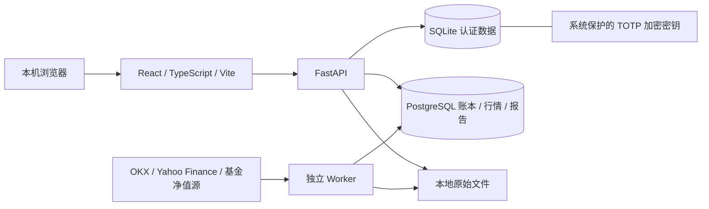

# Portfolio Observatory · 持仓观测站

A local-first investment workspace for tracking portfolios, analyzing returns and monitoring risk across stocks, funds and crypto.

**v0.4.0** · 个人本地部署 · React / TypeScript / ECharts + FastAPI + PostgreSQL + SQLite authentication

把多平台账单汇入一个本地工作台，看清持仓、收益来源与风险。

> 完整源码在 [`release/v0.4.0`](https://github.com/Wentxiang123/portfolio-observatory/tree/release/v0.4.0)，首次发布快照为 [`v0.4.0`](https://github.com/Wentxiang123/portfolio-observatory/tree/v0.4.0)。`main` 暂保留仓库入口，通过 [PR #1](https://github.com/Wentxiang123/portfolio-observatory/pull/1) 审阅。分支上的文档继续完善，固定标签不移动。

## 阅读导航

- [功能](#功能) · [Windows / VS Code 启动](#windows--vs-code-启动)
- [数据与安全](#数据与安全) · [验证](#验证) · [版本与目录](#版本与目录)
- [项目定位与使用流程](#项目定位与使用流程) · [架构](#架构)
- [手工启动与停止](#手工启动与停止) · [首次注册与账户恢复](#首次注册与账户恢复)
- [文件导入与标准格式](#文件导入与标准格式) · [指标与计算口径](#指标与计算口径)
- [行情来源与更新策略](#行情来源与更新策略) · [配置项](#配置项)
- [备份和升级](#备份和升级) · [常见问题](#常见问题)
- [后续计划与贡献](#后续计划与贡献)

## 功能

- 支付宝、moomoo、OKX 多平台来源，统一投资账户，按币种汇总。
- CSV / XLSX 导入、部分 OKX PDF 适配、候选记录核对、去重、原子入账与撤销。图片与未知 PDF 保留原文，需人工补录；尚未实现通用 OCR。
- 净持仓、移动加权成本、浮盈、已实现收益、费用与价格贡献、集中度及情景分析；条件不足时不输出虚构指标。
- OKX 7×24 小时参考行情，股票/ETF 交易所日历与延迟标记，支付宝基金最新已公布日终净值。行情不会改变持仓数量，买卖仍需手动导入。
- 本地用户名 / Argon2id 密码 + 标准 TOTP、二维码绑定、一次性恢复代码、限流、防重放和安全会话。
- Windows DPAPI 保护 TOTP 加密密钥；独立 Local Mode。SMTP 配置与旧实现保留，但当前不启用邮件认证。
- 冻结快照报告和审计记录。新闻采集、自动外部推送、完整日度收益序列尚未实现。

## Windows / VS Code 启动

需要 Python 3.12、Node.js 24、PostgreSQL 17 与 VS Code。PostgreSQL 默认安装目录为 `C:\Program Files\PostgreSQL\17\bin`；其他路径请调整 `scripts/setup.ps1`。

```powershell
git clone --branch release/v0.4.0 https://github.com/Wentxiang123/portfolio-observatory.git
cd portfolio-observatory
py -3.12 -m venv services/api/.venv
.\services\api\.venv\Scripts\python.exe -m pip install -r services/api/requirements-dev.txt
cd apps/web
npm.cmd ci
cd ../..
```

打开 `个性化持仓量化分析平台.code-workspace`，执行 VS Code 任务 **平台：启动全部**，访问 http://127.0.0.1:5173 。初始化创建项目私有 PostgreSQL，默认端口 55432；不会改动系统默认 5432 数据库。首次安装为空工作空间，不包含真实或演示持仓。

首次选择「注册」，设置用户名和至少 12 位密码，使用 Microsoft / Google Authenticator 扫码并验证，再安全保存只展示一次的恢复代码。已有私有安装迁移应选择「原账户升级」；不要将新注册当作旧账户恢复。

完整步骤见 [本地认证与恢复指南](本地认证与恢复指南_v0.4.md)。日常开发可单独运行 API、Worker 和 Vite；具体命令见 `.vscode/tasks.json`。

## 数据与安全

认证保存在本地 SQLite；账本、报价、报告保存在本地 PostgreSQL。原始文件和认证密钥位于 `var/private`，数据库连接配置位于 `.env`。这些文件以及真实账单、个人研究报告、恢复代码均不随仓库分发。

账户模式默认只监听 localhost，持仓等接口需要完成二步认证。Local Mode 是用户主动选择的免网页登录模式，以操作系统访问权限作为信任边界。本版不面向公网或多租户服务。

DPAPI 密钥通常绑定原 Windows 用户及系统环境，复制 SQLite 和密钥文件到另一台机器不保证可恢复。请同时保护系统备份、数据备份与恢复代码；Docker 不替代密钥管理或磁盘加密。

同币种汇总，不将 USDT 自动视为 USD，也不产生未配置汇率的跨币种总资产。公开股票行情可能延迟；本项目不提供交易所授权实时行情承诺。量化结果用于个人复盘，不进行自动交易。

## 验证

启动项目数据库后，在项目根目录运行：

```powershell
.\services\api\.venv\Scripts\python.exe -m pytest tests -q --tb=short
cd apps/web
npm.cmd run build
npm.cmd run lint
```

测试使用随机 PostgreSQL schema 与临时 SQLite，测试凭据均为生成或虚构值。公开版本移除了使用私人账单的黄金样例及真实持仓断言。直接依赖版本记录在 `services/api/requirements.lock.txt`；前端依赖使用 `package-lock.json`。

## 版本与目录

源码位于隔离分支 `release/v0.4.0`；`main` 暂为仓库入口，通过 PR 审阅后合并。见 [VERSIONING.md](VERSIONING.md)。这是私有开发工作空间的脱敏发布副本，未上传私人工作目录或 Git 历史。

- `apps/web`：前端。
- `services/api/app`：认证、行情、账本、API 与 Worker。
- `migrations`：PostgreSQL 迁移。
- `tests`：财务和认证回归测试。
- `scripts`：本地初始化、备份升级与数据库密码维护。

不同版本部署应使用独立配置、密钥和数据库；Git 分支隔离不等于运行数据隔离。

## 项目定位与使用流程

持仓观测站面向个人投资复盘：支付宝基金、moomoo 股票和 OKX 现货统一展示，底层仍按来源与计价币分别核对现金、成本和交易。用户不必先创建各个平台的子账户。

核心流程是：

1. **导入**：操作后上传交易记录，选择平台来源和计价币。
2. **核对**：对照原文件确认资产、数量、费用、时间、记录标识；必要时补行或修改。
3. **入账**：保存核对并预览现金和持仓，再确认入账。
4. **估值**：检查行情关联，Worker 自动获取最新可用参考价。
5. **复盘**：查看持仓、收益贡献、静态风险情景并导出冻结快照报告。

交易数量与成本由用户确认的流水决定，行情刷新不会自行加减仓。接受某种文件不代表能自动读懂所有平台版式。当前 AI 研究、政策采集及消息推送仍属于规划，尚未接入大模型自动分析或外部通知服务。

## 架构



| 层次 | 实现 |
|---|---|
| 界面 | React、TypeScript、Vite、ECharts |
| API 与计算 | Python、FastAPI、Pydantic、SQLAlchemy、Decimal |
| 财务存储 | PostgreSQL 17、Alembic 数据库迁移 |
| 认证 | SQLite、Argon2id、PyOTP、qrcode、Fernet |
| 密钥保护 | Windows 当前用户 DPAPI；其他平台预留系统密钥环实现 |
| 行情调度 | 公开 HTTP 接口、交易所日历、失败退避 |
| 验证 | pytest、TypeScript 生产构建、Oxlint |

SQLite 只负责认证，财务账本继续使用 PostgreSQL。当前不需要 Redis、云数据库、SMTP 或交易账户 API 密钥。本版实际验收环境为 Windows，macOS / Linux 的系统密钥环实现尚未实机验收。

## 手工启动与停止

完成前述依赖安装后，从项目根目录初始化或启动数据库：

```powershell
.\scripts\setup.ps1
```

首次初始化生成随机数据库密码并写入 `.env`，与网页密码独立。**不要提前用 `.env.example` 覆盖 `.env`**；需要可选配置时按示例追加，并保留原来的 `DATABASE_URL`。

接着打开三个 PowerShell 终端：

```powershell
# 终端 1：API，从项目根目录运行
$env:PYTHONPATH = "$PWD\services\api"
.\services\api\.venv\Scripts\python.exe -m uvicorn app.main:app --host 127.0.0.1 --port 8000 --reload --reload-dir services/api
```

```powershell
# 终端 2：导入及行情 Worker，从项目根目录运行
$env:PYTHONPATH = "$PWD\services\api"
.\services\api\.venv\Scripts\python.exe -u -m app.worker
```

```powershell
# 终端 3：Web，从项目根目录运行
cd apps/web
npm.cmd run dev
```

| 服务 | 默认地址 |
|---|---|
| Web | `http://127.0.0.1:5173` |
| API | `http://127.0.0.1:8000` |
| 健康检查 | `http://127.0.0.1:8000/api/health` |
| 项目数据库 | `127.0.0.1:55432` |

停止对应服务使用终端 `Ctrl+C` 或 VS Code「终止任务」。关闭 API / Worker 不会自动停止 PostgreSQL。需要停库时，先停止 API 和 Worker，再从项目根目录执行：

```powershell
& 'C:\Program Files\PostgreSQL\17\bin\pg_ctl.exe' -D "$PWD\var\private\postgres" -m fast -w stop
```

VS Code 调试入口包含 FastAPI、Worker 和 Edge 前端调试，Python 断点调试需安装相应扩展。不要同时通过任务和调试启动同一服务。`npm run build` 只生成前端产物，不会自动启动 API 或生产服务器。

## 首次注册与账户恢复

### 注册和绑定

1. 用户名为 2–40 位字母、汉字、数字、点、短横线或下划线，大小写不区分，不支持 `#` 等其他符号。
2. 设置至少 12 位密码，继续绑定 Authenticator。
3. 使用 Microsoft Authenticator 或 Google Authenticator 扫码；手工绑定选择基于时间、6 位、30 秒、SHA-1。
4. 输入当前动态码，验证后才正式启用账户。待绑定状态不能读取持仓。
5. 保存只展示一次的 10 枚恢复代码，再进入工作台。

后续登录先验证密码，再验证动态码。已用于绑定、登录或安全操作的码不能重复使用，连续操作需等待下一组。电脑和手机需保持正确的系统时间。

### 原账户升级

已有持仓请选择「原账户升级」，验证原密码后沿用原数据 owner。未绑定过邮箱的旧本地账户原用户名通常为 `owner`；已绑定邮箱的使用原用户名。普通注册会创建独立工作空间，不能代替原账户认领。

### 恢复方式

| 情况 | 所需凭据 |
|---|---|
| Authenticator 丢失，仍记得密码 | 原密码 + 一枚未使用的恢复代码 |
| 忘记密码，仍有 Authenticator | 新动态码 + 一枚未使用的恢复代码 |
| 两者均丢失 | 两枚不同且未使用的恢复代码 |

恢复验证通过后立即撤销旧会话，要求绑定新的 Authenticator；完成后旧绑定和旧恢复代码失效。仅凭用户名不能重置，全部凭据遗失时没有免验证网页恢复入口。恢复中断及密钥丢失的处理见 [认证指南](本地认证与恢复指南_v0.4.md)。

### Local Mode

Local Mode 是明确选择的单用户免网页登录模式，能够使用本机的人也能访问该工作空间。已保护账户切换为 Local Mode 需要密码和新动态码，未登录请求不能降级保护。模式是实例级配置，不是每个浏览器独立配置。

账户模式会话最长 12 小时，连续 30 分钟无请求过期；页面自动刷新也算请求。认证使用 HttpOnly / SameSite Cookie、限流、防重放及会话版本校验。本地身份验证不依赖联网认证服务，但行情抓取仍需联网。

## 文件导入与标准格式

| 类型 | 当前支持程度 |
|---|---|
| CSV | 标准列，UTF-8 / GB18030，常见分隔符自动识别 |
| XLSX | 第一张工作表使用标准列，不执行公式 |
| OKX PDF | 自动处理已适配的统一交易表格，其他版式需人工核对 |
| 其他 PDF | 提取文字，未匹配表格时手工补录或转为标准表格 |
| PNG / JPG / JPEG / WebP | 保存原图用于核对，当前不自动 OCR |

moomoo 和支付宝优先使用标准模板；不要假设任意原生导出文件都已适配。网页可下载模板，示例数据需替换后再上传真实账单。

标准列为：

```text
source_id,occurred_at,kind,symbol,currency,quantity,price,fee,fee_currency
```

| 字段 | 含义 |
|---|---|
| `source_id` | 原始记录 / 订单标识，重复导入保持一致 |
| `occurred_at` | 带时区的 ISO 时间，例如 `2026-01-02T10:00:00+08:00` |
| `kind` | `BUY`、`SELL`、`DEPOSIT`、`WITHDRAWAL`、`OPENING`、`DIVIDEND`、`FEE` |
| `symbol` | 资产代码；现金流水使用相应币种代码 |
| `currency` | 账本计价币，需与上传选择一致 |
| `quantity` | 正数，买卖为扣资产币手续费前的成交数量 |
| `price` | 成交价；资产期初填已知历史单位成本；现金流水填 `1` |
| `fee` | 非负，无费用也需明确填写 `0` |
| `fee_currency` | 交易资产币或计价币；第三币种费用暂不自动入账 |

以下是**虚构示例**，不要与真实账单混用：

```csv
source_id,occurred_at,kind,symbol,currency,quantity,price,fee,fee_currency
demo-deposit,2026-01-02T10:00:00+08:00,DEPOSIT,USD,USD,1000,1,0,USD
demo-buy,2026-01-02T22:30:00+08:00,BUY,DEMO,USD,2,100,1,USD
```

费用未知不能默认填 0，期初成本未知不能用 0 代替。系统按来源与标识去重，改来源 ID 不是修订旧流水的正确方式。撤销保留历史并检查后续交易依赖，当前尚无完整冲正替换向导。期权、融资、合约、质押、拆合股与红利再投资未原生适配。

## 指标与计算口径

核心金额使用十进制，API 返回十进制字符串，页面按显示位数四舍五入。

| 指标 | 当前口径 |
|---|---|
| 净持仓 | 买卖和期初数量汇总，扣除以资产币支付的费用 |
| 持仓成本 | 移动加权成本；报价币买入手续费计入成本 |
| 持仓市值 | 净持仓数量 × 最新可用参考价 |
| 未实现收益 | 市值 − 剩余持仓成本 |
| 已实现收益 | 卖出收入扣相关费用，再减结转成本 |
| 持仓收益率 | 单个持仓未实现收益 ÷ 剩余成本，不是 TWR 或年化收益率 |
| 来源内集中度 | 完整估值时，最大单资产价值占该来源资产与现金的比例 |
| 价格冲击情景 | 对已定价风险资产施加 ±10% / ±20% / ±30% 冲击，现金不变 |

账本要求以下关系能够勾稽：

```text
资产市值 + 现金 − 净流入 − 期初基准
= 未实现收益 + 已实现收益 + 收入 − 独立费用
```

- 交易费用已进入成本或损益，不再次重复扣除。
- 缺价时展示已定价部分，依赖完整估值的指标不可用，不将未知价格当作 0。
- 同币种可汇总；未配置汇率时，不跨币种计算统一金额或全账户集中度。
- 价格贡献及买入批次归因在行情完整、未发生卖出等条件下展示。
- 参考 24 小时变化还要求单资产、窗口内无流水、持仓完整性确认及可用起点价格；它与累计盈亏是不同指标，不能相加。
- 静态情景不是概率预测，也不是 VaR；消息相关性不能直接认定为收益因果。
- TWR、XIRR、最大回撤、夏普、年化波动率及完整闭合交易胜率尚未实现，不用不完整数据生成貌似精确的结果。

## 行情来源与更新策略

| 资产 | 来源 | 正常调度策略 |
|---|---|---|
| OKX 现货 | OKX 公共 ticker | 全天约 30 秒轮询 |
| 股票 / ETF | Yahoo Finance 公开 chart | 交易时段约 60 秒，收盘后与休市时调整调度 |
| 支付宝基金 | 天天基金 / 东方财富单位净值 | 按公布时段定时查询，只取已公布日终净值 |

这些是轮询策略，不是行情新鲜度保证。请求失败、网络中断、限流及退避可能延后刷新；失败时保留旧价并显示状态，逐资产披露价格时间、来源、延迟及净值日期。

股票目前通过 HTTP 接口获取参考行情，没有使用 `yfinance` Python 包，也未取得交易所实时行情授权。日历配置包含 US、HK、CN_SH、CN_SZ、JP、GB 等市场，具体资产仍需核对资产类型、市场、供应商代码和币种，不仅凭同名 ticker 认定为同一资产。

基金可能在晚间或之后的工作日公布，QDII 可能更晚。当日未公布时显示最新已公布日期，不将上一日净值标成当天收盘价。万份收益不能当作单位净值。

## 配置项

参考 [`.env.example`](.env.example)，不要提交真实 `.env`。

| 配置 | 作用 |
|---|---|
| `DATABASE_URL` | PostgreSQL 连接串，默认由初始化脚本生成 |
| `AUTO_QUOTES` | 默认 `true`；设为 `false` 后重启 Worker 停止自动行情循环 |
| `COOKIE_SECURE` | localhost HTTP 默认为 `false`，不是公网部署配置 |
| `ALLOWED_HOSTS` | 允许的 Host，仍受回环地址访问检查限制 |
| `ALLOWED_ORIGINS` | 允许的写请求来源；更改前端端口时需同步核对 |
| `SMTP_HOST` / `SMTP_PORT` / `SMTP_SECURITY` | 保留的邮件配置，当前不启用认证邮件 |
| `SMTP_USERNAME` / `SMTP_PASSWORD` / `SMTP_FROM` | 保留供未来使用，当前不必填写 |
| `APP_SECRET` | 旧邮箱模块配置，不用作当前 TOTP 主密钥 |

不要直接重新挂载 `auth_email_legacy.py` 的旧路由，未来邮箱功能需要纳入当前二步认证、会话及恢复策略。OCR 依赖预留在 `services/ocr`，不代表自动识别功能已接入。

## 备份和升级

| 位置 | 数据 |
|---|---|
| `var/private/postgres` | PostgreSQL 数据文件 |
| `var/private/uploads` | 用户原始上传 |
| `var/private/authentication/auth.sqlite3` | 认证记录、加密 Secret、哈希、会话、限流和审计 |
| `var/private/authentication/masterkey.dpapi` | Windows 当前用户 DPAPI 保护的主密钥 |
| `.env` | 数据库及可选配置 |

推荐使用 PostgreSQL `pg_dump` 逻辑备份，同时保存上传文件、认证数据和配置。运行中的 SQLite 使用 backup API，或停止 API 后复制认证目录；不要复制正在写入的 PostgreSQL 数据目录当作可靠备份。

已有 v0.3 安装升级前，从项目根目录运行：

```powershell
.\services\api\.venv\Scripts\python.exe scripts/upgrade_v04.py
```

脚本先备份，再初始化本地认证并比较交易事件指纹，备份进入 `var/private/backups`。它不替代完整上传文件及系统环境备份，也不会替你完成真实 Authenticator 绑定。

DPAPI 通常绑定原 Windows 用户和系统环境。仅复制 SQLite 与密钥文件到新电脑，不保证可解密；需要保留可恢复的系统环境并验证备份。恢复代码不能解密丢失的系统主密钥，当前尚无跨设备密钥迁移向导。

SQLite 元数据、账本与原始文件并非全部加密；DPAPI 保护认证主密钥，不等于整盘加密。个人本地使用不要求云数据库，仍需保护系统账户和备份介质。

## 常见问题

**启动后没有持仓？** 公开版本是空工作空间。上传并确认入账后才会出现；旧安装请选择原账户升级。

**用户名包含 `#` 报错？** 用户名仅允许文档列出的字符。密码可以包含 `#`，新密码至少 12 位。

**刚绑定后，同一验证码无法登录？** 绑定已经消费该动态码，等待下一组，并检查手机和电脑时间。

**上传一直等待解析，或价格不更新？** 检查 Worker 是否运行、设置页心跳及错误状态；行情还需要网络、正确资产映射和 `AUTO_QUOTES=true`。

**基金不是今天的价格？** 当日尚未公布、非交易日或跨境基金公布较晚时，只展示最新已公布日期的净值。

**收益或风险指标为空？** 检查历史、行情、净值序列及对应计算条件，未知数据不会被默认补为 0。

**PowerShell 拒绝执行脚本？** 先核对脚本及本机策略。在允许的个人环境，可对当前终端临时执行 `Set-ExecutionPolicy -Scope Process -ExecutionPolicy Bypass` 后重试，无需永久修改全局策略；组织策略可能禁止更改。

**端口占用或数据库连接失败？** 检查 5173、8000、55432 的现有服务和日志，保留 `.env` 原凭据，不要删除数据库目录尝试修复。端口修改需同步配置。

**历史研究报告返回 404？** 公开源码不包含私人研究报告，该入口仅供本机已保存材料使用，不是实时新闻服务。

## 后续计划与贡献

首次公开源码验证记录为 **46 项后端测试通过，前端 build / lint 通过**，不是持续集成状态。测试使用随机 PostgreSQL schema 和临时 SQLite，覆盖账本、认证、隔离及行情回归。部分依赖存在弃用提示，图表包存在构建体积提示。

以下是后续方向，不代表已实现或承诺发布时间：

- 更多支付宝 / moomoo 原生版式、OCR 与置信度核对。
- 跨平台转账匹配、汇率折算与汇率贡献拆分。
- 日度净值、现金流时点估值、TWR / XIRR、回撤与交易评价。
- 企业行动、完整买卖归因与冲正修订向导。
- 新闻 / 政策证据采集、持仓关联、AI 辅助解释与可配置推送。
- 自动备份、恢复验证与跨设备密钥迁移。

后续改动使用 `feature/<topic>` 或独立修复分支，经 PR 审阅，不强制覆盖共享分支，不移动已发布版本标签。不同版本的运行环境仍需独立配置与数据库，详见 [VERSIONING.md](VERSIONING.md)。

提交问题时提供复现步骤和脱敏最小示例，不提交真实账单、数据库备份、令牌、密码、Authenticator 二维码/Secret 或恢复代码。新增文件也需要人工检查，不能只依赖 `.gitignore`。

当前仓库尚未声明开源许可证，公开可见不代表已授予某一开源许可证下的使用权。引入第三方组件时应核对其许可。本项目用于个人记录和复盘，不进行自动下单，收益解释和静态风险情景不构成收益保证。
